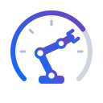
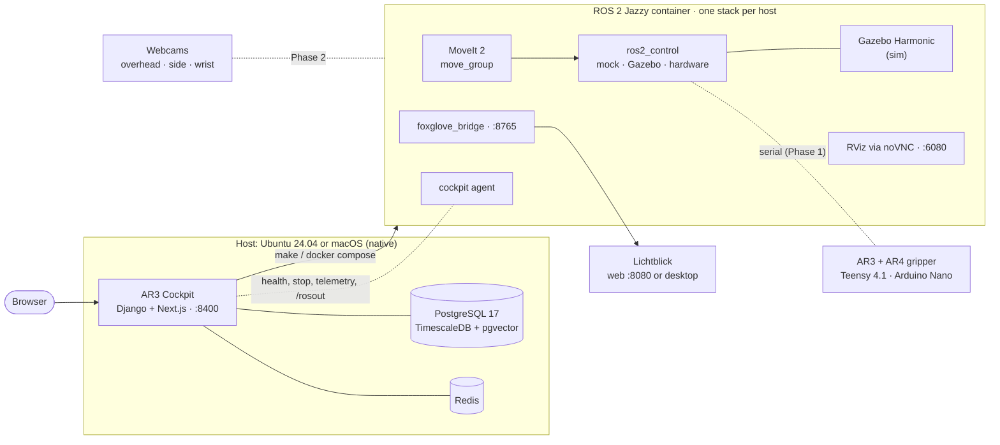

<div align="center">

<picture>
  <source media="(prefers-color-scheme: dark)" srcset="tools/cockpit/frontend/public/brand/ar3-cockpit-mark.svg">
  
</picture>

# AR3 Robotic Arm Cockpit

**A ROS 2 manipulation stack and web cockpit for the open-source [Annin Robotics](https://anninrobotics.com/) AR3 arm:<br>
simulate on a Mac or Linux, then run the same software on the real robot.**

[](https://docs.ros.org/en/jazzy/)
[](https://moveit.picknik.ai/)
[](https://gazebosim.org/docs/harmonic)
[](https://ubuntu.com/)
[](docs/manual/usage-mac.md)
[](docker/)
[](https://www.python.org/)
[](LICENSE.md)
[](#roadmap)
[](https://github.com/rpetrasch/AR_Robotic_Arm_Cockpit/actions/workflows/ci.yml)

[Demo](#demo) · [Quickstart](#quickstart) · [Architecture](#architecture) · [Usage](#usage) · [AR3 Cockpit](#ar3-cockpit) · [Roadmap](#roadmap) · [Docs](#documentation)

</div>

---

## Demo

<table>
  <tr>
    <th width="50%">Start</th>
    <th width="50%">Demo</th>
  </tr>
  <tr>
    <td></td>
    <td></td>
  </tr>
</table>

▶️ **[Explainer video](https://drive.google.com/file/d/1Y6dxzuI2C3YoEgxF4dp9pSmWIm7fph0D/view?usp=sharing)**: the full walkthrough with captions (Google Drive).

## About

The [**AR3**](https://robodk.com/robot/Annin-Robotics/AR3) is a 6-axis, stepper-driven, open-source desktop robot arm designed by Chris Annin of
[**Annin Robotics**](https://anninrobotics.com/). Build manuals, CAD files and the original control software are on the
[Annin Robotics downloads page](https://anninrobotics.com/downloads). Its successor, the AR4, is the arm Annin Robotics develops today.

This repository turns an AR3, fitted with the AR4 servo gripper, into a ROS 2 robot:

- **Robot model and motion planning:** URDF/xacro, MoveIt 2 (OMPL and Pilz), `ros2_control`, named poses.
- **Simulation:** a mock robot (no physics) and a Gazebo Harmonic workcell with table, bins, objects and cameras.
- **Runs anywhere:** Docker images for `amd64` and `arm64`. Linux workstations get native RViz and Gazebo windows; Apple Silicon Macs run headless with Lichtblick and RViz in the browser (noVNC).
- **AR3 Cockpit:** a local web app that installs, starts, monitors and explains the stack, and shows the CLI command behind every action.

**Goal**, in order of delivery: pick-and-place → object detection (multi-webcam) → sorting → learned policies (ACT, SmolVLA) trained on recorded demonstrations. The classical pipeline stays the baseline and the safety fallback.

> [!NOTE]
> **Current state:** simulation (Phases 0 and 0b) and Cockpit phases C1–C5 work. Real-hardware support (Phase 1) is not merged yet, so `mode:=real` is refused. See the [roadmap](#roadmap).

## Architecture



Dashed lines are planned. The stack is described by two choices:
- the **robot**: `mock`, `sim` (Gazebo) or later `real`;
- the **viewer**: RViz window, RViz in the browser, or Lichtblick.

`foxglove_bridge` runs in every stack, so Lichtblick can always connect. Only one ROS stack runs per host; two would share port 8765 and the ROS graph, giving two MoveIts and two robots.

<details>
<summary><b>ROS-level view (Phase 0)</b></summary>

```
                  config/ (robot.yaml, bins.yaml, cameras.yaml)
                                  │
                       ar3_description (xacro)
                  ┌───────────────┼──────────────────┐
           robot_description   SRDF (ar3_moveit_config)
                  │               │
   ┌──────────────┴───────┐   move_group ◄── RViz MotionPlanning
   │ mode:=mock           │       │        ◄── ros2 run ar3_bringup move_to_named
   │  ros2_control_node   │       │ FollowJointTrajectory / GripperCommand
   │  (mock_components)   │◄──────┘
   │ mode:=sim            │
   │  Gazebo + gz_ros2_   │──► /cam_overhead/*, /cam_wrist/* (ros_gz_bridge)
   │  control             │
   └──────────────────────┘──► /joint_states, /tf
```

</details>

## Quickstart

**Prerequisites:** git, make, Docker (daemon running, usable without `sudo`). The cockpit also needs [uv](https://docs.astral.sh/uv/) and Node.js ≥ 22. A Linux workstation with an NVIDIA GPU should also have the NVIDIA Container Toolkit.

```bash
git clone https://github.com/rpetrasch/AR_Robotic_Arm_Cockpit.git
cd AR_Robotic_Arm_Cockpit
```

### Option A: with the AR3 Cockpit (recommended)

```bash
./cockpit.sh            # or: make cockpit
```

Open **http://127.0.0.1:8400** and create the first user; this works from the cockpit host only. Then go to **Install & Setup**. It checks your machine, builds the images and the workspace, and runs the tests, with live logs. **Continue setup** runs the next missing step. Each step shows the command it runs, so you can also run it yourself.

On the first run `cockpit.sh` creates `.env` in the repository root with generated secrets (git-ignored). Keep it: the cockpit's database keeps the password it was created with.

### Option B: manually

```bash
make image              # build the dev image for your architecture (once)
make ws-build           # colcon build inside the container
make docker-test        # unit + mock integration tests
```

Start one stack:

| Host | Robot | Viewer | Command |
|---|---|---|---|
| **Linux** | mock | RViz window | `make up-linux` |
| **Linux** | Gazebo | Gazebo + RViz windows | `make sim-linux` (`GPU=1` with NVIDIA, `HEADLESS=1` without a display) |
| **Mac** | mock | Lichtblick | `make up-mac` |
| **Mac** | Gazebo (headless) | Lichtblick | `make sim-mac` |
| **Mac** | mock | RViz in browser + Lichtblick | `make vnc` |
| **Mac** | Gazebo (headless) | RViz in browser + Lichtblick | `AR3_MODE=sim make vnc` |
| any | | | `make down` stops the running stack |

On Linux with a display, run `xhost +local:docker` once so the containers can open windows.

## Usage

**Move the arm.** Plan and execute in the RViz MotionPlanning panel, or call the named poses from a second terminal:

```bash
docker compose -f docker/compose.yaml run --rm dev \
  ros2 run ar3_bringup move_to_named observe stow home
```

With Gazebo, the arm moves in the simulated workcell and the overhead and wrist cameras publish on `/cam_overhead/*` and `/cam_wrist/*`.

**Viewers**

| Viewer | How |
|---|---|
| Lichtblick (web) | `make lichtblick` → http://localhost:8080, connect to `ws://localhost:8765`, load the layout `config/lichtblick/ar3_default.json` |
| Lichtblick (desktop) | Open connection → Foxglove WebSocket → `ws://localhost:8765` |
| RViz in the browser | `make vnc` → http://localhost:6080/vnc.html |
| RViz / Gazebo windows | Linux: `make up-linux` / `make sim-linux` |

**Other useful targets** (each is documented with a `##` comment in the [Makefile](Makefile))

| Command | What it does |
|---|---|
| `make shell` | interactive shell in the dev container |
| `make test` / `make test-sim` | unit + mock tests / headless Gazebo integration test |
| `make lint` | ruff + format check |
| `make doctor` | the Install & Setup checklist in the terminal |
| `make status-json` | host, running stack and viewers as JSON |
| `make zenohd` / `make remote` | Workstation A: Zenoh router · Mac: join Workstation A's ROS graph |
| `make` / `make help` | all targets with their descriptions |

**Configuration.** Nothing needs configuring for the Quickstart. For overrides there are two files, both git-ignored:

| File | For | Template |
|---|---|---|
| `.env` | the AR3 Cockpit: LAN access, AI assistant (Ollama / Anthropic key), ports, telemetry; plus its generated secrets | [.env.example](.env.example), every key in [defaults.env](tools/cockpit/backend/defaults.env) |
| `docker/.env` | the ROS stacks: ROS middleware, Zenoh router address (REMOTE mode) | [docker/.env.example](docker/.env.example) |

## AR3 Cockpit

<p align="center">
  
</p>

A local web app that puts all the ways of running the stack behind one UI. It runs natively on the host, not in Docker, so it sees the real OS and controls containers without mounting the Docker socket.

| Menu | What it does | Status |
|---|---|---|
| **Install & Setup** | Checklist of everything the stack needs; whitelisted fix steps with live logs and error hints | ✅ C2 |
| **Environment** | Detects the OS, shows the valid modes, starts/stops stacks, explains every component with its CLI commands, links to the viewers | ✅ C3 (REAL pre-flight wizard waits for Phase 1) |
| **Monitoring** | Logs, telemetry, ROS graph, alerts; data capture into TimescaleDB | ✅ C4 |
| **Simulations** | Create, edit and run MoveIt 2 scenarios; run history and compare; pack-and-go between cockpits | ✅ C5 (`pick_place` / `sort` wait for Phase 3) |
| **Assistant** | Answers about ROS 2, MoveIt, Gazebo and the AR3 from the repo docs, with sources; explains job warnings and errors, helps write scenarios; local (Ollama) or Anthropic | ✅ C6 |

The header is always visible and shows status, mode, host, viewer links and a **software** stop. That stop is not an e-stop: in an emergency, use the hardware e-stop.

Stack: Django 5 + DRF + Channels, Next.js + HeroUI, PostgreSQL/TimescaleDB, Redis. Details in [docs/manual/cockpit.md](docs/manual/cockpit.md); the full spec is [docs/specs/spec_cockpit.md](docs/specs/spec_cockpit.md).

## Hardware

| Part | Setup |
|---|---|
| Arm | Annin AR3, 6 steppers with encoders and limit switches, position-controlled |
| Arm controller | Teensy 4.1 (upgrade from the AR3's Teensy 3.5) running the [ar4_ros_driver](https://github.com/ycheng517/ar4_ros_driver) firmware, with 3.3 V level shifting for the AR3's 5 V signals |
| Gripper | AR4 servo gripper on an Arduino Nano with an ACS712 current sensor (grasp detection) |
| Safety | Dual-channel hardware e-stop: cuts motor power, signals the Teensy; software reset required |
| Cameras | USB webcams: overhead, 1–2 side, wrist. A depth camera is deferred |
| Compute | Ubuntu 24.04 workstations with NVIDIA GPUs (robot host, AI host); Apple Silicon Macs for development |

> [!WARNING]
> A real robot arm can injure people and damage itself. Real-hardware support is work in progress. Before running anything with `mode:=real`, read the wiring, e-stop and pre-flight sections in [docs/specs/spec_v0.4.md](docs/specs/spec_v0.4.md).

## Roadmap

| Phase | Content | Status |
|---|---|---|
| 0 | Workspace, robot description, MoveIt, mock + Gazebo simulation, CI | ✅ |
| 0b | macOS profile, multi-arch images, Lichtblick, noVNC, Zenoh | ✅ |
| C1–C6 | Cockpit: sign-in, status header, Install & Setup, Environment (start/stop, components, agent), Monitoring + data capture, Simulations, assistant | ✅ |
| 1 | Real hardware: Teensy 4.1 firmware, hardware interface, safety, e-stop | ⏳ |
| 2 | Calibration and multi-webcam perception (YOLO, triangulation) | ⏳ |
| 3 | Pick, place, sort (behavior trees) | ⏳ |
| 4–5 | Teleop, data recording (LeRobot), ACT / SmolVLA policies | ⏳ |

The full plan with acceptance criteria per phase is in [docs/specs/spec_v0.4.md](docs/specs/spec_v0.4.md).

## Repository layout

```
├── cockpit.sh              # AR3 Cockpit bootstrap
├── Makefile                # every way to build, test and run (targets documented with ##)
├── config/                 # robot, cameras, bins, Lichtblick layout, cockpit components
├── docker/                 # Dockerfile, compose profiles (linux, mac, vnc, cockpit)
├── docs/                   # specs, install, usage, testing, troubleshooting
├── src/
│   ├── ar3_description/    # URDF/xacro: arm, gripper, table, bins, camera mounts
│   ├── ar3_moveit_config/  # SRDF, kinematics, limits, OMPL + Pilz, named poses
│   ├── ar3_bringup/        # bringup.launch.py mode:=mock|sim, controllers, move_to_named
│   ├── ar3_gazebo/         # Gazebo world, objects, camera bridges
│   ├── ar3_cockpit_agent/  # the cockpit's HTTP adapter in the stack (health, software stop)
│   └── external/           # vendored ar4_ros_driver (pinned)
├── tests/
└── tools/cockpit/          # AR3 Cockpit: Django backend, Next.js frontend
```

## Documentation

| Topic | Link |
|---|---|
| Install (native Ubuntu, Docker) | [docs/manual/install.md](docs/manual/install.md) |
| Simulation | [docs/manual/usage-sim.md](docs/manual/usage-sim.md) |
| Mac | [docs/manual/usage-mac.md](docs/manual/usage-mac.md) |
| AR3 Cockpit | [docs/manual/cockpit.md](docs/manual/cockpit.md) · [components](docs/manual/cockpit-components.md) |
| Testing | [docs/dev/testing.md](docs/dev/testing.md) |
| Troubleshooting | [docs/manual/troubleshooting.md](docs/manual/troubleshooting.md) |
| Specs | [stack](docs/specs/spec_v0.4.md) · [cockpit](docs/specs/spec_cockpit.md) |
| Changelogs | [Phase 0](docs/changelog/phase0.md) · [Phase 0b](docs/changelog/phase0b.md) · [Cockpit C1](docs/changelog/cockpit-c1.md) · [C2](docs/changelog/cockpit-c2.md) · [C3](docs/changelog/cockpit-c3.md) · [C4](docs/changelog/cockpit-c4.md) · [C5](docs/changelog/cockpit-c5.md) · [C6](docs/changelog/cockpit-c6.md) |

## Contributing

Issues and pull requests are welcome. Before opening a PR:

```bash
make lint && make docker-test
```

The project is spec-driven: larger changes start as an update to the spec in `docs/`, and every phase updates the docs it affects.

## Contributors

<table>
  <tr>
    <td align="center" width="160">
      <a href="https://github.com/r1rich"><br><b>Richard Petrasch</b></a><br>
      <a href="https://github.com/r1rich">@r1rich</a><br>
      <a href="mailto:richard@amdisx.com">richard@amdisx.com</a>
    </td>
    <td align="center" width="160">
      <a href="https://github.com/rpetrasch"><br><b>Roland Petrasch</b></a><br>
      <a href="https://github.com/rpetrasch">@rpetrasch</a><br>
      <a href="mailto:roland.petrasch@gmail.com">roland.petrasch@gmail.com</a>
    </td>
  </tr>
</table>

## Acknowledgements

- [Annin Robotics](https://anninrobotics.com/) and Chris Annin for the AR3/AR4 design, manuals and control software.
- [ycheng517/ar4_ros_driver](https://github.com/ycheng517/ar4_ros_driver), the ROS 2 driver this stack builds on.
- [ROS 2](https://docs.ros.org/en/jazzy/), [MoveIt 2](https://moveit.picknik.ai/), [Gazebo](https://gazebosim.org/), [Lichtblick](https://github.com/lichtblick-suite/lichtblick), [noVNC](https://novnc.com/), [Zenoh](https://zenoh.io/) and [LeRobot](https://github.com/huggingface/lerobot).

## License

The code of this project is licensed (see [License](LICENSE.md),
© 2026 Richard Petrasch and Roland Petrasch.

Third-party parts keep their own licenses; see [THIRD_PARTY_NOTICES.md](THIRD_PARTY_NOTICES.md). In particular:
- the vendored [ar4_ros_driver](src/external/ar4_ros_driver) is MIT (© Dexter Ong);
- the microcontroller firmware in `src/external/ar4_ros_driver/annin_ar4_firmware/` is © Chris Annin under his own terms, which **prohibit selling** robots or software based on it;
- the AR4 meshes are derived from Annin Robotics' CAD models.
